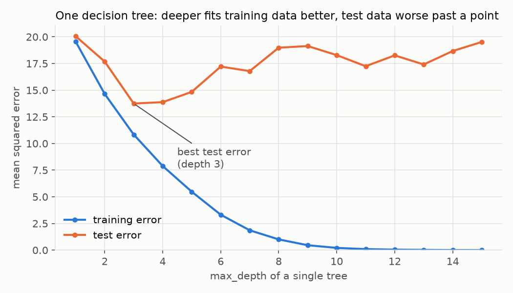
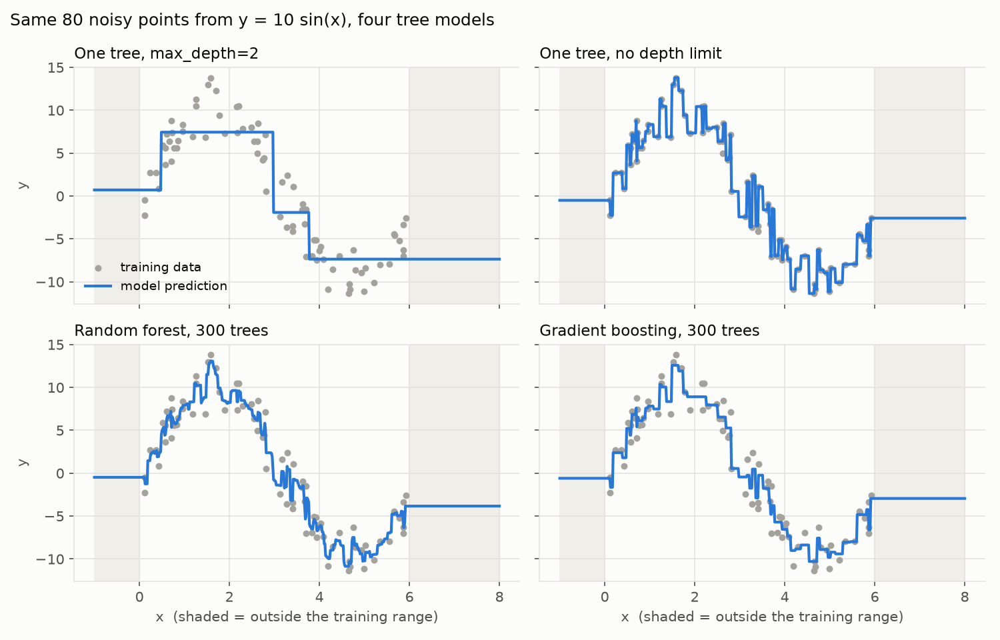
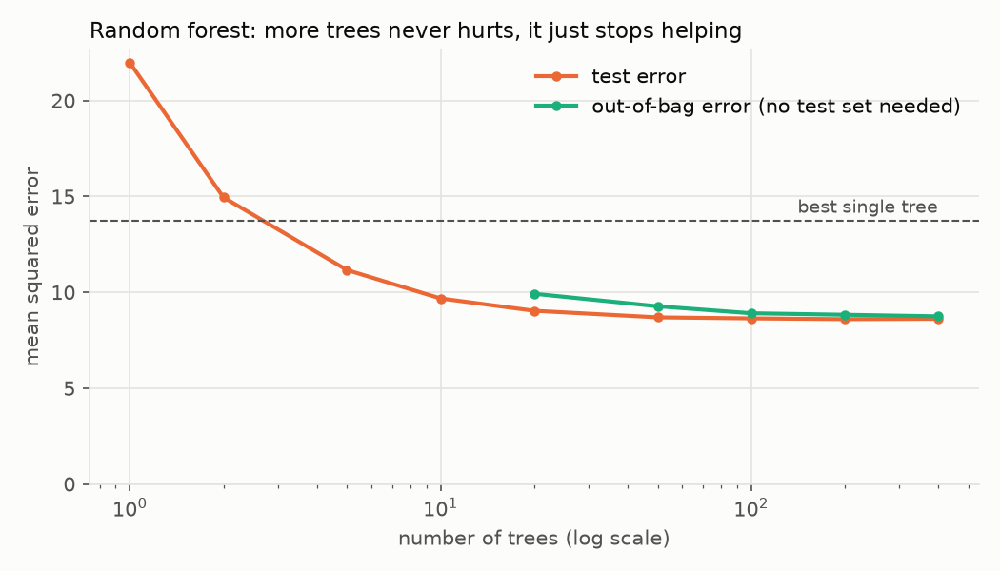
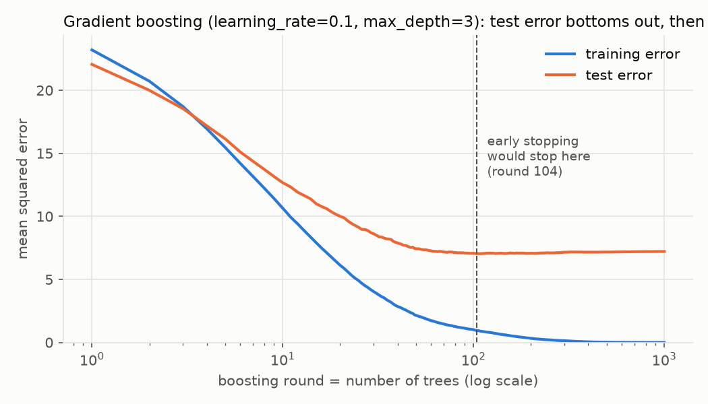
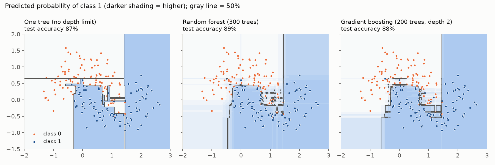

# Random Forests and Gradient-Boosted Trees

## Learning Goal

Understand the two most-used models for **tabular data** (rows and columns, like a spreadsheet or a SQL table): the **random forest** and **gradient-boosted trees** (GBT). By the end you should be able to explain:

- how a single decision tree makes predictions and how it's built,
- why averaging many trees (random forest) works, and why the randomness matters,
- what a **gradient** is, what **boosting** is, and why gradient boosting is "gradient descent with trees",
- what each model's knobs (hyperparameters) do,
- which one to reach for on a given problem, and what neither of them is good at.

The two models are built from the same part, a decision tree, and combine trees in opposite ways. That's why they share one lesson:

```text
Random forest:     many deep trees, built independently, averaged        -> reduces variance
Gradient boosting: many shallow trees, built one after another,          -> reduces bias
                   each fixing the previous trees' mistakes
```

The path:

```text
Part 0  The problem                 predicting a column from other columns; overfitting
Part 1  Decision trees              nested if/else, learned from data
Part 2  Why averaging helps         the variance of an average (with and without correlation)
Part 3  Random forest               bootstrap rows + random features + average
Part 4  Gradients                   slopes, gradient descent, and the key twist
Part 5  Gradient boosting           fit the mistakes, step by step; classification with e and ln
Part 6  Random forest vs GBT        side by side, and how to choose
Part 7  Worked case                 predicting S&P 500 index additions
Part 8  What they're not            common confusions
```

Prerequisites: programming, basic statistics (mean, variance), derivatives. The math lessons `../math/e_and_ln.md`, `../math/variance_covariance.md` and `../math/taylor_series.md` are used along the way and linked where needed.

The charts in this lesson come from real runs of scikit-learn 1.5.2 on small synthetic datasets. The script that made them is `../scripts/ml_figures.py`.

---

# Part 0: The Problem

## 0.1 Predicting a column from other columns

You have a table. Each **row** is one example (a company, a loan, a customer). Some columns describe the example; one column is the thing you want to predict.

| Company | Market cap (\$B) | Profitable? | Sector | ... | **Added to index next quarter?** |
|---|---|---|---|---|---|
| A | 22 | yes | Tech | ... | **yes** |
| B | 18 | yes | Health | ... | **no** |
| ... | | | | | |

As a programmer, think of it as: you want a function

```python
def predict(row) -> value: ...
```

but instead of writing its logic by hand, you want to **learn** it from past rows whose answers you already know.

## 0.2 Vocabulary

| Term | Meaning |
|---|---|
| **Feature** | An input column (market cap, profitable?). Also called a predictor or variable. |
| **Target** (or label) | The column you're predicting. |
| **Regression** | The target is a number (next month's return, a house price). |
| **Classification** | The target is a category (added / not added, default / no default). Models usually output a **probability** for each category. |
| **Training set** | Rows the model learns from. |
| **Test set** | Rows held back and only used to check how well the model does on data it hasn't seen. |
| **Model** | The learned function. |
| **Hyperparameter** | A setting you choose before training (how deep trees can grow, how many trees). Called **levers** or knobs in this lesson. |
| **Ensemble** | A model made by combining many smaller models. Both models in this lesson are ensembles of trees. |

## 0.3 The real goal: do well on rows you haven't seen

Memorizing the training rows is easy: store them in a dictionary. That's useless for new rows. The goal is **generalization**: doing well on data the model never saw.

**Overfitting** means fitting the training data so closely that you capture its noise, the random quirks that won't repeat. The overfit model scores great on training data and badly on new data. **Underfitting** is the opposite: the model is too simple to capture the real pattern.

That's why we always measure on a **test set**. Every chart below shows training error and test error separately, and the gap between them is the story.

**High level:** a model is only as good as its performance on data it hasn't seen. Everything in this lesson, the randomness in random forests and the small steps in boosting, exists to fight overfitting while still capturing the real pattern.

---

# Part 1: Decision Trees

## 1.1 A tree is a nested if/else

A **decision tree** is exactly the kind of function a programmer writes by hand, except it's learned from data:

```python
def predict(company):
    if company.market_cap >= 20:          # split 1
        if company.profitable:            # split 2
            return "added"                # leaf
        else:
            return "not added"            # leaf
    else:
        return "not added"                # leaf
```

The same thing drawn as a tree (trees in computer science grow downward):

```text
                    [ market_cap >= 20 ? ]           <- root: the first question
                     /                  \
                   no                   yes
                   /                      \
          (not added)            [ profitable ? ]    <- internal node: another question
                                   /          \
                                 no           yes
                                 /              \
                          (not added)        (added)  <- leaves: the answers
```

Words:

- A **node** asks a yes/no question about one feature, like "is market cap at least 20?". This question is called a **split**.
- A **leaf** is an end point. It holds the prediction.
- **Depth** is the number of questions from the root to the deepest leaf. This tree has depth 2.

To predict for a new row, start at the root, answer each question, and follow the branch until you hit a leaf.

The question is: **how does the algorithm choose the questions?**

## 1.2 Building a regression tree: one split by hand

**The problem.** Six data points. We want to predict $y$ from $x$:

| $x$ | 1 | 2 | 3 | 4 | 5 | 6 |
|---|---|---|---|---|---|---|
| $y$ | 10 | 12 | 20 | 22 | 40 | 42 |

**Step 1: the no-question baseline.** With no splits, the best single prediction under squared error is the **mean** (the average): $\frac{10+12+20+22+40+42}{6} = \frac{146}{6} = 24.33$.

How bad is that? Measure with the **sum of squared errors (SSE)**: for each point, take (actual minus prediction), square it, and add up. Squaring makes every error positive and punishes big errors more.

$$\text{SSE} = (10 - 24.33)^2 + (12 - 24.33)^2 + \cdots + (42 - 24.33)^2 = 939.33$$

**Step 2: try every possible split.** A split on $x$ puts the points with small $x$ in a left group and the rest in a right group. Each group predicts its own mean. With 6 sorted points there are 5 places to cut. For each, compute each side's mean and SSE:

| Cut between | Left group | Left mean | Left SSE | Right group | Right mean | Right SSE | **Total SSE** |
|---|---|---|---|---|---|---|---|
| $x=1$ and $2$ | 10 | 10.0 | 0.0 | 12, 20, 22, 40, 42 | 27.2 | 692.8 | 692.8 |
| $x=2$ and $3$ | 10, 12 | 11.0 | 2.0 | 20, 22, 40, 42 | 31.0 | 404.0 | 406.0 |
| $x=3$ and $4$ | 10, 12, 20 | 14.0 | 56.0 | 22, 40, 42 | 34.67 | 242.67 | 298.67 |
| $x=4$ and $5$ | 10, 12, 20, 22 | 16.0 | 104.0 | 40, 42 | 41.0 | 2.0 | **106.0** |
| $x=5$ and $6$ | 10, 12, 20, 22, 40 | 20.8 | 564.8 | 42 | 42.0 | 0.0 | 564.8 |

One row worked out in full, the cut between 4 and 5:

1. Left mean: $\frac{10 + 12 + 20 + 22}{4} = \frac{64}{4} = 16$
2. Left SSE: $(10-16)^2 + (12-16)^2 + (20-16)^2 + (22-16)^2 = 36 + 16 + 16 + 36 = 104$
3. Right mean: $\frac{40 + 42}{2} = 41$
4. Right SSE: $(40-41)^2 + (42-41)^2 = 1 + 1 = 2$
5. Total: $104 + 2 = 106$

**Step 3: keep the best.** The cut between 4 and 5 has the smallest total SSE, 106, down from 939.33 with no split. The tree's first question is "is $x \ge 4.5$?" (libraries cut halfway between neighboring values). Left leaf predicts 16, right leaf predicts 41.

**Step 4: repeat inside each group.** The algorithm now treats the left group (10, 12, 20, 22) as its own little dataset and looks for its best split, and the same for the right group. This repeats until a stopping rule says stop: a maximum depth, a minimum number of rows per leaf, or no split that helps.

This is called **greedy** splitting: at each node it takes the best split right now, without looking ahead. It's fast, and it's why trees are cheap to build.

**With many features**, Step 2 tries every cut point of **every** feature and keeps the single best (feature, cut) pair.

## 1.3 Classification trees: Gini impurity

For classification, the leaf predicts the **fraction** of each class among its training rows, and the split score measures how mixed a group is. The standard measure is **Gini impurity**:

$$\text{Gini} = 1 - p^2 - (1-p)^2$$

where $p$ is the fraction of rows in the group that are "yes". It's 0 when the group is pure (all yes or all no) and largest, 0.5, at a 50/50 mix. (Meaning: it's the chance that two rows drawn at random from the group have different labels.)

**Example: 8 index candidates.**

| Company | Market cap (\$B) | Profitable? | Added? |
|---|---|---|---|
| A | 22 | yes | **yes** |
| B | 18 | yes | no |
| C | 25 | yes | **yes** |
| D | 9 | no | no |
| E | 15 | yes | no |
| F | 30 | yes | **yes** |
| G | 12 | no | no |
| H | 28 | no | no |

**Before any split.** 3 of 8 were added, so $p = \frac38 = 0.375$:

$$\text{Gini} = 1 - 0.375^2 - 0.625^2 = 1 - 0.140625 - 0.390625 = 0.46875$$

**Candidate split 1: market cap ≥ 20.**

- Left (cap < 20): B, D, E, G. None added, $p = 0$, Gini $= 1 - 0 - 1 = 0$. Pure.
- Right (cap ≥ 20): A, C, F, H. 3 of 4 added, $p = 0.75$, Gini $= 1 - 0.5625 - 0.0625 = 0.375$.
- Weighted by group size: $\frac48 \times 0 + \frac48 \times 0.375 = 0.1875$.

**Candidate split 2: profitable?**

- Profitable: A, B, C, E, F. 3 of 5 added, $p = 0.6$, Gini $= 1 - 0.36 - 0.16 = 0.48$.
- Not profitable: D, G, H. None added, Gini $= 0$.
- Weighted: $\frac58 \times 0.48 + \frac38 \times 0 = 0.30$.

**Pick the lower one.** Market cap ≥ 20 leaves less impurity (0.1875 vs 0.30), so it becomes the root. Then the right group (A, C, F, H) is split again. "Profitable?" separates it perfectly: A, C, F are profitable and added, H isn't and wasn't. That builds exactly the tree from Section 1.1.

## 1.4 Depth controls overfitting

Keep splitting and eventually every leaf holds one training row. The tree then reproduces the training data perfectly, noise included. Here is a single tree on a noisy dataset (600 rows, half for training, half for testing), at different maximum depths:



| max_depth | 1 | 2 | 3 | 4 | 6 | 10 | 15 |
|---|---|---|---|---|---|---|---|
| Training MSE | 19.54 | 14.65 | 10.84 | 7.89 | 3.32 | 0.21 | 0.00 |
| Test MSE | 20.05 | 17.68 | **13.75** | 13.88 | 17.21 | 18.29 | 19.52 |

(MSE, the **mean squared error**, is the SSE divided by the number of rows.)

Training error falls all the way to 0. Test error is best at depth 3 and then gets *worse*. Past depth 3, the extra splits are fitting noise.

Two names for the two failure modes:

- **Bias**: error from a model too simple to capture the pattern. A depth-1 tree has high bias.
- **Variance**: error from a model so flexible that it changes a lot depending on which noisy training rows it happened to see. A depth-15 tree has high variance.

A single tree is stuck choosing between them. **The two ensembles in this lesson are two different escapes:** random forests take high-variance deep trees and average away the variance. Gradient boosting takes high-bias shallow trees and adds them up to remove the bias.

## 1.5 Trees and $\ln$: transforming a feature changes nothing

A tree only ever asks "is this feature at least some cutoff?". It never multiplies or adds feature values. So any transformation that keeps the **order** of the values gives exactly the same splits.

Example: market caps 9, 12, 15, 18, 22, 25, 28, 30. Their natural logs (`../math/e_and_ln.md`) are 2.20, 2.48, 2.71, 2.89, 3.09, 3.22, 3.33, 3.40. Since $\ln$ is increasing, the order is the same. "Cap ≥ 20" and "ln(cap) ≥ 3.00" put exactly the same companies on each side (because $\ln 20 = 3.00$).

So for trees:

- You **don't** need to scale, standardize, or log-transform features. (A linear model does care.)
- Outliers in a feature barely matter: a market cap of 3,000 is just "bigger than every cutoff".

But transforming the **target** does matter. Predicting $\ln(\text{price})$ instead of price changes which errors the model is penalized for, and the leaf averages become averages of logs. That's a modeling choice, not a no-op.

## 1.6 What a single tree is good and bad at



The top row shows single trees fitting 80 noisy points from $y = 10\sin(x)$:

- **Depth 2 (top left)**: four flat steps. Too simple (high bias).
- **No depth limit (top right)**: chases every noisy point (high variance).
- **Predictions are always step functions.** A tree's output is piecewise constant: one value per leaf.
- **Shaded regions**: outside the training range ($x < 0$ or $x > 6$), every model just repeats its edge value. **Trees cannot extrapolate.** They can only output averages of training targets they've seen.

Good at: mixed feature types, nonlinear patterns, interactions ("big **and** profitable"), no preprocessing, fast predictions, readable if shallow.

Bad at: smooth relationships (needs many steps), extrapolation, stability (a slightly different dataset can give a very different tree; see Part 2).

**High level:** a decision tree is a learned nested if/else. It picks each question greedily to make the groups as pure as possible. Alone, it's either too simple or too jumpy. The rest of this lesson is about combining many trees to get the best of both.

---

# Part 2: Why Averaging Helps

## 2.1 Deep trees are unstable

A deep tree has low bias but high variance: retrain it on a slightly different sample of rows and you get a noticeably different tree with different predictions. Each tree is right **on average** but noisy.

Averaging noisy estimates is a classic way to reduce noise. How much does it help? That's a variance calculation.

## 2.2 Averaging independent predictions

Suppose $n$ trees each make a prediction $X_1, \ldots, X_n$ for the same row. Each has variance $\sigma^2$ (how much it wobbles from one training sample to another). The ensemble predicts their average:

$$\bar X = \frac{1}{n}(X_1 + X_2 + \cdots + X_n)$$

If the trees were **independent**:

1. Pull out the constant $\frac1n$. Constants come out of a variance squared, $\operatorname{Var}(cY) = c^2\operatorname{Var}(Y)$:

$$\operatorname{Var}(\bar X) = \frac{1}{n^2}\operatorname{Var}(X_1 + \cdots + X_n)$$

2. For independent variables, the variance of a sum is the sum of the variances (all covariances are 0; see `../math/variance_covariance.md`):

$$= \frac{1}{n^2}\left(\sigma^2 + \cdots + \sigma^2\right) = \frac{1}{n^2}\cdot n\sigma^2$$

3. Cancel one $n$:

$$= \frac{\sigma^2}{n}$$

100 independent trees would have $\frac{1}{100}$ of the variance of one tree. That would be wonderful, but there's a catch.

## 2.3 The catch: trees trained on the same data are correlated

Trees trained on similar data make similar mistakes. Say every pair of trees has correlation $\rho$ (rho), so the covariance of any two is $\rho\sigma^2$.

1. Start as before:

$$\operatorname{Var}(\bar X) = \frac{1}{n^2}\operatorname{Var}(X_1 + \cdots + X_n)$$

2. The variance of a sum is now the sum of all variances **plus** the covariance of every ordered pair $(i, j)$ with $i \ne j$. There are $n$ variance terms and $n(n-1)$ ordered pairs:

$$= \frac{1}{n^2}\left(n\sigma^2 + n(n-1)\rho\sigma^2\right)$$

3. Split the fraction into two pieces:

$$= \frac{n\sigma^2}{n^2} + \frac{n(n-1)\rho\sigma^2}{n^2} = \frac{\sigma^2}{n} + \frac{(n-1)\rho\sigma^2}{n}$$

4. Write $\frac{n-1}{n} = 1 - \frac1n$ and expand:

$$= \frac{\sigma^2}{n} + \rho\sigma^2 - \frac{\rho\sigma^2}{n}$$

5. Group the two terms with $\frac1n$:

$$\boxed{\operatorname{Var}(\bar X) = \rho\,\sigma^2 + \frac{(1-\rho)\,\sigma^2}{n}}$$

Check: with $\rho = 0$ this is $\frac{\sigma^2}{n}$, matching 2.2. ✓ With $\rho = 1$ (identical trees) it's $\sigma^2$: averaging copies does nothing. ✓

**Numbers**, with $\sigma^2 = 1$:

| Trees $n$ | $\rho = 0$ | $\rho = 0.3$ | $\rho = 0.6$ |
|---|---|---|---|
| 1 | 1.000 | 1.000 | 1.000 |
| 10 | 0.100 | 0.370 | 0.640 |
| 100 | 0.010 | 0.307 | 0.604 |
| 1000 | 0.001 | 0.301 | 0.600 |

One cell worked out: $\rho = 0.3$, $n = 100$ gives $0.3 + \frac{0.7}{100} = 0.3 + 0.007 = 0.307$.

## 2.4 What the formula says to do

The formula has two terms, and each one is a lever:

- $\frac{(1-\rho)\sigma^2}{n}$ shrinks as you add trees. **More trees** kill this term, but with diminishing returns: going from 100 to 1000 trees at $\rho = 0.3$ only moves 0.307 to 0.301.
- $\rho\sigma^2$ **doesn't shrink with more trees at all.** It's a floor. The only way to lower it is to make the trees **less correlated**.

**High level:** averaging many trees cuts variance, but only down to a floor set by how similar the trees are. So the recipe for a great ensemble of deep trees is: many trees, and make them as different from each other as you can while keeping each one decent. That's the random forest.

---

# Part 3: Random Forest

A random forest makes its trees different in two ways: each tree sees a different random sample of **rows**, and each split considers a random subset of **features**. Then it averages.

## 3.1 Randomness 1: bootstrap the rows

A **bootstrap sample** is $n$ rows drawn **with replacement** from the $n$ training rows. "With replacement" means after you draw a row, you put it back, so it can be drawn again.

**Example**, 6 rows A–F, one random draw of 6:

```text
draws:   B  E  E  B  C  E
unique:  B, C, E          (B twice, E three times)
left out: A, D, F
```

Each tree trains on its own bootstrap sample, so each tree sees a somewhat different dataset and grows a somewhat different tree. Training many models on bootstrap samples and averaging them is called **bagging** (**b**ootstrap **agg**regat**ing**).

**How many rows does each tree miss? An appearance of $e$.**

1. One draw picks a particular row (say A) with probability $\frac1n$, so it misses A with probability $1 - \frac1n$.
2. The $n$ draws are independent, so the chance A is missed by **all** of them is the product of $n$ copies:

$$P(\text{row A never drawn}) = \left(1 - \frac{1}{n}\right)^n$$

3. This is the compounding expression from `../math/e_and_ln.md`, $\left(1 + \frac{r}{n}\right)^n \to e^{r}$, with $r = -1$. (The same limit argument works for negative $r$; we take that as given.) So as $n$ grows,

$$\left(1 - \frac{1}{n}\right)^n \to e^{-1} = \frac{1}{e} = 0.3679$$

| Rows $n$ | $\left(1 - \frac1n\right)^n$ |
|---|---|
| 6 | 0.3349 |
| 10 | 0.3487 |
| 100 | 0.3660 |
| 1,000 | 0.3677 |
| limit | $e^{-1} = 0.3679$ |

So each tree never sees about **36.8%** of the rows, and trains on the other **63.2%** ($1 - e^{-1}$), some of them repeated. In the 6-row example above, 3 of 6 rows were left out; the formula says 33.5% on average, and one random draw can easily land at 50%.

## 3.2 Free validation: out-of-bag (OOB) error

The left-out rows are a gift. For each training row, about 37% of the trees never saw it. Predict that row using **only those trees**, compare to the true answer, and average over all rows. That's the **out-of-bag error**: an honest estimate of test error without holding out a test set.

In the chart in Section 3.6, the OOB error (green) tracks the real test error (orange) closely: 8.75 vs 8.61 at 400 trees.

## 3.3 Randomness 2: a random subset of features at each split

Bootstrapping alone leaves the trees quite correlated. If one feature is very strong (say market cap), almost every tree will split on it first, and the trees will look alike near the top. That keeps $\rho$ high, and Section 2.4 says a high $\rho$ is a floor that more trees can't fix.

The fix: **at every split, only let the tree choose among a random subset of the features.** If you have 9 features and the subset size is 3, each split looks at 3 randomly chosen features and picks the best cut among those 3 only.

- Sometimes market cap isn't in the subset, so the tree has to split on something else. Other useful features get a chance to shape some trees.
- Each individual tree gets slightly worse (it sometimes misses the best split), but the trees become **much less correlated**, which lowers the floor $\rho\sigma^2$. The trade is usually well worth it.

The subset size is the lever `max_features`. A common default for classification is $\sqrt{p}$, where $p$ is the number of features: with 9 features, 3 per split.

## 3.4 The algorithm

```python
def train_random_forest(rows, n_trees, max_features):
    forest = []
    for _ in range(n_trees):                       # each tree is independent
        sample = bootstrap(rows)                   # n rows, with replacement
        tree = grow_tree(sample,                   # usually grown deep (no depth limit)
                         features_per_split=max_features)
        forest.append(tree)
    return forest

def predict(forest, row):
    preds = [tree.predict(row) for tree in forest]
    return mean(preds)                             # regression: average
                                                   # classification: average the probabilities
```

Because the trees don't depend on each other, the loop can run **in parallel** on all your CPU cores.

## 3.5 Combining the trees' answers

**Regression:** average the numbers.

**Classification:** each tree outputs a probability (the fraction of "yes" in its leaf), and the forest averages them. Example, 5 trees scoring one candidate company:

| Tree | 1 | 2 | 3 | 4 | 5 |
|---|---|---|---|---|---|
| P(added) | 0.8 | 0.6 | 0.9 | 0.4 | 0.7 |

Forest probability: $\frac{0.8 + 0.6 + 0.9 + 0.4 + 0.7}{5} = \frac{3.4}{5} = 0.68$. (An older variant counts votes instead: 4 of 5 trees say above 0.5, so "added". Libraries like scikit-learn average probabilities.)

## 3.6 How many trees? More never hurts



| Trees | 1 | 2 | 5 | 10 | 20 | 50 | 100 | 400 |
|---|---|---|---|---|---|---|---|---|
| Test MSE | 21.98 | 14.96 | 11.16 | 9.68 | 9.04 | 8.69 | 8.64 | 8.61 |

(Same dataset as Section 1.4. The best single tree scored 13.75.)

Two things to see:

1. **The error falls fast, then flattens.** That's the $\frac{(1-\rho)\sigma^2}{n}$ term shrinking toward the floor $\rho\sigma^2$.
2. **It never turns back up.** Adding trees only averages more of the same kind of thing, so it can't overfit more. More trees costs time and memory, not accuracy.

Also notice the forest beats the best single tree (8.61 vs 13.75), even though every tree in the forest is grown with no depth limit. A single unlimited tree on this data scores 17.97.

## 3.7 Levers

Names follow scikit-learn's `RandomForestClassifier` / `RandomForestRegressor`.

| Lever | What it does | Effect | Typical setting |
|---|---|---|---|
| `n_estimators` | Number of trees | More = more stable, never worse; slower | 200–1000; increase until the OOB error stops improving |
| `max_features` | Features considered per split | Lower = less correlated trees (lower $\rho$) but each tree weaker | Classifier default $\sqrt{p}$; regressor default is all features, and $\frac{p}{3}$ or 0.3–0.5 of $p$ is often better |
| `max_depth`, `min_samples_leaf` | How big each tree can grow | Larger leaves = smoother, less noisy predictions, slightly more bias | Defaults grow full trees; raise `min_samples_leaf` to 5–50 on noisy data or for smoother probabilities |
| `max_samples` | Fraction of rows in each bootstrap | Smaller = more diverse trees, faster | Default all rows; 0.5–0.8 on large data |
| `class_weight` | Upweights rare classes | Helps when "yes" is rare | `"balanced"` for imbalanced classification |
| `oob_score` | Compute the OOB error | Free validation | `True` |
| `n_jobs` | Parallel cores | Speed only | `-1` (all cores) |

The forest is famously **forgiving**: the defaults are usually close to the best you'll get, and the main thing to tune is `max_features` and leaf size.

## 3.8 Feature importance, and its traps

Forests report which features mattered. Two kinds:

- **Impurity importance** (the default `feature_importances_`): total impurity reduction from splits on each feature, averaged over trees. Fast, but **biased toward features with many distinct values** (an ID-like column can look important), and computed on training data.
- **Permutation importance**: shuffle one feature's column in the **test** data and measure how much the score drops. Slower but more honest.

Both share two traps: correlated features **split the credit** between them (two copies of the same signal each look half as important), and **importance is not causation**. It says the model uses a feature, not that the feature drives the outcome.

**High level:** a random forest grows hundreds of deep, deliberately different trees (different rows, different features at each split) and averages them. Averaging removes most of the variance that makes a single deep tree unreliable. It's hard to misuse, needs little tuning, can't be hurt by adding trees, and gives you a free validation score.

---

# Part 4: Gradients

Before boosting, we need the idea that gives "gradient boosting" its name.

## 4.1 From slope to gradient

**One variable.** The derivative $f'(x)$ is the slope: how fast $f$ rises as $x$ increases. If $f'(x) > 0$, going right goes uphill. If $f'(x) < 0$, going right goes downhill.

**Many variables.** For a function of several inputs, $f(x_1, x_2, \ldots)$, take the slope in each direction separately. These are the **partial derivatives** $\frac{\partial f}{\partial x_1}, \frac{\partial f}{\partial x_2}, \ldots$ (the symbol $\partial$ means "derivative with respect to one input, holding the others fixed"). Stacked into a vector, they form the **gradient**:

$$\nabla f = \left(\frac{\partial f}{\partial x_1},\ \frac{\partial f}{\partial x_2},\ \ldots\right)$$

($\nabla$ is read "nabla" or "grad".) The gradient points in the direction of **steepest increase**. So the **negative** gradient points steepest **downhill**.

## 4.2 Gradient descent, by hand

**The problem.** Find the $x$ that minimizes $f(x) = (x - 3)^2$. (We know the answer is 3, so we can check.)

**The method.** Start somewhere and repeatedly take a small step downhill:

$$x_{\text{new}} = x - \eta\, f'(x)$$

$\eta$ (eta) is the **learning rate**: how big a step to take. The minus sign is what makes it go *downhill*: if the slope is positive, decrease $x$.

Here $f'(x) = 2(x - 3)$ (power rule and chain rule). Take $\eta = 0.1$ and start at $x = 0$:

| Step | $x$ | Slope $f'(x) = 2(x-3)$ | Step $= -0.1 \times \text{slope}$ | New $x$ | Distance to 3 |
|---|---|---|---|---|---|
| 0 | 0.0000 | −6.0000 | +0.6000 | 0.6000 | 3.0000 |
| 1 | 0.6000 | −4.8000 | +0.4800 | 1.0800 | 2.4000 |
| 2 | 1.0800 | −3.8400 | +0.3840 | 1.4640 | 1.9200 |
| 3 | 1.4640 | −3.0720 | +0.3072 | 1.7712 | 1.5360 |
| 4 | 1.7712 | −2.4576 | +0.2458 | 2.0170 | 1.2288 |

Each step closes 20% of the remaining distance (the distance goes 3.0, 2.4, 1.92, ...: multiplied by 0.8 each time). Steps get smaller automatically as the slope flattens near the bottom.

## 4.3 The twist that makes boosting work: the gradient with respect to the predictions

In most of machine learning (including neural networks), gradient descent adjusts a model's **parameters** (weights). A tree has no smooth parameters to differentiate; it's a bunch of if/else cutoffs.

Gradient boosting instead treats **the predictions themselves** as the things to adjust. Write $F_i$ for the model's current prediction on training row $i$, and $y_i$ for the truth. Measure the error with a **loss function** $L(y_i, F_i)$. Then ask: if I nudged the prediction $F_i$, which way would the loss go down?

**For squared error**, use $L = \tfrac12(y - F)^2$. (The $\frac12$ is only there to cancel the 2 from differentiating.)

1. Differentiate with respect to $F$, using the chain rule. The outside is $\frac12 u^2$ with $u = y - F$, whose derivative is $u$. The inside $u = y - F$ has derivative $-1$ with respect to $F$:

$$\frac{\partial L}{\partial F} = (y - F)\cdot(-1) = -(y - F)$$

2. The **negative** gradient, the downhill direction, is

$$-\frac{\partial L}{\partial F} = y - F$$

**That's the residual: actual minus predicted.** So "nudge each prediction in the direction of its residual" is exactly "take a gradient descent step on the predictions". This one observation is the whole connection between boosting and gradients.

The negative gradient is often called the **pseudo-residual**, because for other loss functions it isn't literally "actual minus predicted", but it plays the same role (Section 5.5).

**High level:** a gradient points uphill; stepping against it, in small steps, walks you to a minimum. Gradient boosting applies that idea to the *predictions*, and for squared error the downhill direction is simply each row's residual.

---

# Part 5: Gradient Boosting

## 5.1 The idea: a team that fixes its own mistakes

**Boosting** builds a strong model from **weak learners**, models only a little better than guessing, by adding them **one at a time**, where each new one focuses on what the current team still gets wrong.

```text
start:    F0 = mean of y                         (a constant guess)
round 1:  residuals r = y - F0   -> fit a small tree h1 to r
          F1 = F0 + nu * h1
round 2:  residuals r = y - F1   -> fit a small tree h2 to r
          F2 = F1 + nu * h2
  ...
final:    F  = F0 + nu*h1 + nu*h2 + ... + nu*hM
```

$\nu$ (nu) is the **learning rate**, a number like 0.1, and is the same idea as $\eta$ in 4.2.

Each tree is **shallow** (depth 1 to 6). A depth-1 tree, one question and two leaves, is called a **stump**. One stump is a terrible model, but hundreds of them, each correcting the last, can be excellent.

## 5.2 Boosting by hand

Same 6 points as Section 1.2, squared error, stumps, learning rate $\nu = 1$ first (no shrinking) so the steps are easy to follow.

**Round 1.**

1. Start with the mean: $F_0 = 24.33$ for every row.
2. Residuals $y - F_0$: $-14.33, -12.33, -4.33, -2.33, 15.67, 17.67$.
3. Fit a stump to the **residuals**. The best cut is between $x = 4$ and $5$ (same split as Section 1.2, because residuals are just $y$ shifted by a constant). Left leaf = mean of the first four residuals $= -8.33$; right leaf $= 16.67$.
4. Update: $F_1 = F_0 + 1 \times \text{leaf}$. Left rows: $24.33 - 8.33 = 16.00$. Right rows: $24.33 + 16.67 = 41.00$.

**Round 2.**

1. New residuals $y - F_1$: $10 - 16 = -6$, $12 - 16 = -4$, $20 - 16 = 4$, $22 - 16 = 6$, $40 - 41 = -1$, $42 - 41 = 1$.
2. The biggest remaining mistake is inside the left group: rows 1–2 are too high, rows 3–4 too low. The best stump on these residuals cuts between $x = 2$ and $3$: left leaf $= -5$, right leaf $= 2.5$.
3. Update: rows 1–2 become $16 - 5 = 11$; rows 3–4 become $16 + 2.5 = 18.5$; rows 5–6 become $41 + 2.5 = 43.5$.

Round 2's tree is about a completely different part of the data than round 1's. That's the point: each tree works on what's still wrong.

**Six rounds, tracking the training error (MSE):**

| Round | Predictions $F$ (rows 1–6) before the round | MSE before | Stump cut |
|---|---|---|---|
| 1 | 24.33, 24.33, 24.33, 24.33, 24.33, 24.33 | 156.56 | 4 \| 5 |
| 2 | 16.00, 16.00, 16.00, 16.00, 41.00, 41.00 | 17.67 | 2 \| 3 |
| 3 | 11.00, 11.00, 18.50, 18.50, 43.50, 43.50 | 5.17 | 4 \| 5 |
| 4 | 12.25, 12.25, 19.75, 19.75, 41.00, 41.00 | 2.04 | 1 \| 2 |
| 5 | 10.00, 12.70, 20.20, 20.20, 41.45, 41.45 | 1.03 | 4 \| 5 |
| 6 | 10.23, 12.93, 20.43, 20.43, 41.00, 41.00 | 0.93 | 3 \| 4 |

The targets are 10, 12, 20, 22, 40, 42. The error drops fast and the predictions close in on them.

**Now with $\nu = 0.5$.** Each tree's correction is cut in half:

| Round | 1 | 2 | 3 | 4 | 5 | 6 |
|---|---|---|---|---|---|---|
| MSE with $\nu = 1$ | 156.56 | 17.67 | 5.17 | 2.04 | 1.03 | 0.93 |
| MSE with $\nu = 0.5$ | 156.56 | 52.39 | 20.88 | 7.19 | 3.00 | 1.66 |

Slower. So why would anyone want a smaller learning rate? Because on six clean points there's no noise to overfit, but on real data, full-size steps let each tree fit noise aggressively. Small steps spread the learning across many trees, so no single tree's quirks dominate. In practice a small $\nu$ with more trees almost always generalizes better.

## 5.3 Learning rate times number of trees: another appearance of $e$

Imagine an idealized case where each tree fits the residuals **exactly**. Then each round:

1. New prediction: $F_{m} = F_{m-1} + \nu\,r_{m-1}$, where $r_{m-1} = y - F_{m-1}$ is the old residual.
2. New residual: subtract both sides from $y$:

$$r_m = y - F_m = (y - F_{m-1}) - \nu\,r_{m-1} = r_{m-1} - \nu\,r_{m-1} = (1 - \nu)\,r_{m-1}$$

3. Each round multiplies the residual by $(1 - \nu)$. After $m$ rounds:

$$r_m = (1 - \nu)^m\,r_0$$

4. Write $\nu = \frac{\nu m}{m}$. Then $(1 - \nu)^m = \left(1 - \frac{\nu m}{m}\right)^m$, which is the compounding limit from `../math/e_and_ln.md` with rate $-\nu m$. For many rounds,

$$(1 - \nu)^m \approx e^{-\nu m}$$

| $\nu$ | Rounds $m$ | $\nu m$ | $(1-\nu)^m$ | $e^{-\nu m}$ |
|---|---|---|---|---|
| 0.1 | 10 | 1 | 0.3487 | 0.3679 |
| 0.05 | 20 | 1 | 0.3585 | 0.3679 |
| 0.1 | 50 | 5 | 0.00515 | 0.00674 |
| 0.05 | 100 | 5 | 0.00592 | 0.00674 |

**What it means:** to a good approximation, what matters is the product $\nu \times m$, the "total amount of learning". **Halve the learning rate and you need about twice as many trees** to get to the same place. (Real trees don't fit residuals exactly, so this is a rule of thumb, not a law.)

## 5.4 The general algorithm, for any loss

Section 4.3 showed that for squared error the negative gradient is the residual. For any differentiable loss, use the negative gradient as the target for each new tree:

```python
def train_gbt(X, y, loss, n_trees, learning_rate, max_depth):
    F = best_constant(y, loss)                     # e.g. mean for squared error
    trees = []
    for m in range(n_trees):                       # sequential: tree m needs trees 0..m-1
        g = -loss.gradient(y, F)                   # pseudo-residuals, one per row
        tree = fit_tree(X, g, max_depth)           # a small tree that predicts g
        tree.set_leaf_values(...)                  # best step size per leaf for this loss
        F = F + learning_rate * tree.predict(X)
        trees.append(tree)
    return trees

def predict(F0, trees, learning_rate, row):
    return F0 + learning_rate * sum(t.predict(row) for t in trees)
```

Unlike the forest, the loop **can't** run in parallel across trees: tree $m$ needs the predictions from all earlier trees. (Libraries parallelize the work *inside* each tree instead.)

Why "gradient descent in function space"? Each tree is a small step, in the downhill direction, applied to the whole prediction function at once. The final model is the sum of all the steps.

## 5.5 Classification: log-odds, the sigmoid, and log loss (where $e$ and $\ln$ come in)

**The problem.** For "added or not", we want a probability $p$ between 0 and 1. But boosting adds up tree outputs, and a sum of numbers can be anything: $-3$, $7.2$. We need to add freely in one space and turn the result into a probability.

### Step 1: probability to odds to log-odds

- **Odds** $= \frac{p}{1-p}$. A probability of 0.375 has odds $\frac{0.375}{0.625} = 0.6$. Odds range over $(0, \infty)$.
- **Log-odds** $= \ln\frac{p}{1-p}$. Here $\ln 0.6 = -0.5108$. Log-odds range over all real numbers, $(-\infty, \infty)$: exactly what a sum of trees can produce.

So gradient boosting for classification works in **log-odds space**. The model's raw output $F$ is a log-odds, and the trees add to it.

### Step 2: back from log-odds to probability, the sigmoid

Solve $F = \ln\frac{p}{1-p}$ for $p$:

1. Undo the $\ln$ by exponentiating both sides: $e^{F} = \frac{p}{1-p}$
2. Multiply both sides by $(1 - p)$: $e^{F}(1 - p) = p$
3. Expand: $e^{F} - e^{F}p = p$
4. Collect the $p$ terms on one side: $e^{F} = p + e^{F}p = p\,(1 + e^{F})$
5. Divide: $p = \frac{e^{F}}{1 + e^{F}}$
6. Divide top and bottom by $e^F$ (using $\frac{1}{e^F} = e^{-F}$):

$$\boxed{p = \frac{1}{1 + e^{-F}}}$$

This is the **sigmoid** (or logistic) function. Values:

| Log-odds $F$ | −2 | −1 | 0 | 1 | 2 |
|---|---|---|---|---|---|
| $p = \frac{1}{1 + e^{-F}}$ | 0.119 | 0.269 | 0.500 | 0.731 | 0.881 |

$F = 0$ means 50/50. Positive $F$ leans yes, negative leans no, and $p$ never reaches 0 or 1.

### Step 3: the loss, log loss

For classification the standard loss is **log loss** (also called cross-entropy). For one row with true label $y$ (1 = yes, 0 = no) and predicted probability $p$:

$$L = -\big[y\ln p + (1-y)\ln(1-p)\big]$$

Read it in the two cases:

- If $y = 1$, the second term vanishes and $L = -\ln p$. Predicting $p = 0.375$ for a "yes" costs $-\ln 0.375 = 0.981$. Predicting $p = 0.9$ would cost only 0.105.
- If $y = 0$, the first term vanishes and $L = -\ln(1 - p)$. Predicting $p = 0.375$ for a "no" costs $-\ln 0.625 = 0.470$.

Confident wrong answers are punished hard: as $p \to 0$ for a true "yes", $-\ln p \to \infty$.

### Step 4: the gradient of log loss with respect to $F$ is $p - y$

We need $\frac{\partial L}{\partial F}$. Use the chain rule through $p$: $\frac{\partial L}{\partial F} = \frac{\partial L}{\partial p}\cdot\frac{dp}{dF}$.

**First, $\frac{dp}{dF}$.** Write $p = u^{-1}$ with $u = 1 + e^{-F}$.

1. Power rule: $\frac{dp}{du} = -u^{-2}$
2. Chain rule on $e^{-F}$: $\frac{du}{dF} = -e^{-F}$
3. Multiply: $\frac{dp}{dF} = -u^{-2}\cdot(-e^{-F}) = \frac{e^{-F}}{(1 + e^{-F})^2}$
4. Split into two fractions:

$$\frac{dp}{dF} = \frac{1}{1 + e^{-F}}\cdot\frac{e^{-F}}{1 + e^{-F}}$$

5. The first fraction is $p$. The second is $1 - p$, because

$$1 - p = 1 - \frac{1}{1 + e^{-F}} = \frac{1 + e^{-F} - 1}{1 + e^{-F}} = \frac{e^{-F}}{1 + e^{-F}}$$

So:

$$\frac{dp}{dF} = p\,(1 - p)$$

(Check at $F = 0.3$: a numerical slope gives 0.24446, and $p(1-p)$ with $p = 0.5744$ gives 0.24446. ✓)

**Next, $\frac{\partial L}{\partial p}$.** Using $\frac{d}{dp}\ln p = \frac1p$ and $\frac{d}{dp}\ln(1-p) = -\frac{1}{1-p}$:

$$\frac{\partial L}{\partial p} = -\left[\frac{y}{p} - \frac{1-y}{1-p}\right]$$

**Multiply them:**

1. $\frac{\partial L}{\partial F} = -\left[\frac{y}{p} - \frac{1-y}{1-p}\right]\cdot p(1-p)$
2. Distribute $p(1-p)$ into the bracket. The $p$ cancels in the first term and the $(1-p)$ in the second: $= -\big[y(1-p) - (1-y)p\big]$
3. Expand: $= -\big[y - yp - p + yp\big]$
4. The $yp$ terms cancel:

$$\boxed{\frac{\partial L}{\partial F} = p - y}$$

So the negative gradient is $y - p$: **actual label minus predicted probability**, a residual in probability units. The same "fit the residuals" story as squared error.

### Step 5: one boosting round on the 8 candidates

Use the 8 companies from Section 1.3.

1. **Starting point.** 3 of 8 were added, so $p_0 = 0.375$ and $F_0 = \ln\frac{0.375}{0.625} = \ln 0.6 = -0.5108$ for everyone.
2. **Pseudo-residuals** $y - p_0$: added companies (A, C, F) get $1 - 0.375 = 0.625$; the others get $0 - 0.375 = -0.375$.
3. **Fit a stump** to those residuals. It picks market cap ≥ 20, as in Section 1.3. Left leaf: B, D, E, G (all residuals $-0.375$). Right leaf: A, C, F, H (three at $+0.625$, one at $-0.375$).
4. **Leaf values: convert the residual to a log-odds step.** The residuals are in **probability** units, but $F$ is in **log-odds** units. From Step 4, a small change in $F$ moves $p$ by about $p(1-p)$ times as much (a first-order Taylor step; see `../math/taylor_series.md`). So to move $p$ by $\Delta p$ we need $\Delta F \approx \frac{\Delta p}{p(1-p)}$. Libraries apply this per leaf as

$$\text{leaf value} = \frac{\text{sum of residuals in the leaf}}{\text{sum of } p(1-p) \text{ in the leaf}}$$

   With $p(1-p) = 0.375 \times 0.625 = 0.234375$ for every row:
   - Left: $\frac{4 \times (-0.375)}{4 \times 0.234375} = \frac{-1.5}{0.9375} = -1.6$
   - Right: $\frac{3 \times 0.625 + (-0.375)}{4 \times 0.234375} = \frac{1.5}{0.9375} = +1.6$
5. **Update with $\nu = 0.5$.** Left: $F = -0.5108 + 0.5 \times (-1.6) = -1.3108$, so $p = \frac{1}{1 + e^{1.3108}} = 0.2123$. Right: $F = -0.5108 + 0.8 = 0.2892$, so $p = 0.5718$.
6. **Did it help?** Average log loss before: 0.6616. After one round: 0.4350.

H (big, unprofitable, not added) moved the wrong way, from 0.375 to 0.572, because it shares a leaf with the added companies. The next round's residuals will flag H (residual $0 - 0.572 = -0.572$), and a split on "profitable?" will pull it back down. That's boosting: each round fixes what the last left wrong.

(Dividing by $p(1-p)$ like this is a **Newton step**: it uses the second derivative, the curvature, as well as the gradient. XGBoost's documentation calls the second derivative the **hessian**. It's one reason XGBoost and LightGBM often need fewer rounds than plain gradient steps would.)

## 5.6 More trees can overfit, so use early stopping

Unlike a random forest, boosting **keeps fitting the training data** as you add trees, eventually including its noise:



Same dataset as Sections 1.4 and 3.6, learning rate 0.1, depth-3 trees:

| Round | 10 | 50 | **104** | 1000 |
|---|---|---|---|---|
| Test MSE | 12.67 | 7.42 | **7.04** | 7.21 |
| Training MSE | | | | 0.0002 |

Training error goes to essentially 0. Test error bottoms out at round 104 and then slowly gets worse.

The fix is **early stopping**: hold out a validation set, track its error after each round, and stop when it hasn't improved for, say, 50 rounds. The number of trees is then chosen for you, which is why you can set `n_estimators` high and let early stopping pick the cutoff.

At its best (7.04), the boosted model beats the random forest on this dataset (8.61), which beats the best single tree (13.75). Boosting usually wins when tuned, but it needs the tuning.

## 5.7 Levers

Names are given for scikit-learn's `HistGradientBoosting*` / XGBoost / LightGBM where they differ.

| Lever | What it does | Effect | Typical setting |
|---|---|---|---|
| `learning_rate` (XGBoost `eta`) | Shrinks each tree's contribution | Smaller = better generalization, needs more trees (Section 5.3) | 0.01–0.1 |
| `n_estimators` (`max_iter`, `num_boost_round`) | Number of rounds | Too many overfits | Set high, let early stopping choose |
| Early stopping (`early_stopping_rounds`, `callbacks`) | Stops when validation stops improving | Picks the number of trees for you | Always on, with a validation set |
| `max_depth` / `num_leaves` (LightGBM) / `max_leaf_nodes` | Size of each tree | Bigger = captures more interactions per tree, overfits faster | depth 3–8, or 15–63 leaves |
| `min_child_samples` (`min_child_weight`, `min_samples_leaf`) | Minimum data per leaf | Larger = fewer noisy leaves | 20–100 on noisy data |
| `subsample` (`bagging_fraction`) | Fraction of rows per tree | Adds randomness (like bagging), fights overfitting | 0.5–0.9 |
| `colsample_bytree` (`feature_fraction`) | Fraction of features per tree | Same idea as `max_features` in a forest | 0.5–0.9 |
| `reg_lambda`, `reg_alpha` (`l2_regularization`) | Penalizes large leaf values | Smaller, safer steps | Tune if overfitting |
| `scale_pos_weight` / `class_weight` | Upweights the rare class | Imbalanced classification | Ratio of negatives to positives, or "balanced" |

A good tuning order: fix `learning_rate` at 0.05–0.1 with early stopping, tune tree size (`max_depth` / `num_leaves`, `min_child_samples`), then `subsample` / `colsample_bytree`, then regularization, and finally lower the learning rate and let early stopping add trees.

## 5.8 Implementations

| Library | Notes |
|---|---|
| scikit-learn `GradientBoostingClassifier/Regressor` | The textbook version. Fine for small data, slow on large. |
| scikit-learn `HistGradientBoostingClassifier/Regressor` | Bins features into histograms, so it's much faster. Handles missing values. Good default inside scikit-learn. |
| XGBoost | Newton steps plus regularization. Very widely used. Defaults: depth 6, learning rate 0.3. |
| LightGBM | Very fast, grows trees leaf-by-leaf (`num_leaves`). Defaults: 31 leaves, learning rate 0.1. |
| CatBoost | Strong handling of categorical features, good defaults, less tuning. |

They're all gradient-boosted trees. The differences are speed, defaults, and handling of missing values and categories, not the core idea.

**High level:** gradient boosting starts from a constant guess and adds small trees one at a time. Each new tree fits the current mistakes (the negative gradient of the loss with respect to the predictions), and its output is shrunk by the learning rate. For classification it works in log-odds, so $e$ and $\ln$ convert to and from probabilities, and the gradient of log loss is simply $p - y$. It's usually the most accurate option for tabular data, but more trees can overfit, so it needs a validation set and early stopping.

---

# Part 6: Random Forest vs Gradient Boosting

## 6.1 The structure, side by side

```text
RANDOM FOREST (bagging)                        GRADIENT BOOSTING
                                                
  data --+--> bootstrap 1 --> deep tree 1 --+     data --> F0 (constant)
         +--> bootstrap 2 --> deep tree 2 --+                |
         +--> bootstrap 3 --> deep tree 3 --+--> average     v   residuals -> small tree 1
         +--> ...                            |           F1 = F0 + nu*tree1
         +--> bootstrap N --> deep tree N --+                |   residuals -> small tree 2
                                                           F2 = F1 + nu*tree2
  trees are independent: build in parallel                   |   ...
                                                           FM = final model
                                              each tree depends on all earlier ones: sequential
```

## 6.2 Bias and variance: opposite strategies

| | Random forest | Gradient boosting |
|---|---|---|
| Individual trees | Deep: low bias, high variance | Shallow: high bias, low variance |
| How they combine | Average | Add up, each fixing the last |
| Mainly reduces | Variance | Bias |
| Danger | Can't fix bias the trees all share | Can fit noise if it runs too long |

## 6.3 On the same data



Two-class data (200 training points, 200 test points). The single tree's boundary is blocky and chases individual points. The forest and boosted model both produce smoother, more sensible regions:

| Model | Test accuracy | Test log loss |
|---|---|---|
| One tree (no depth limit) | 87.0% | 4.49 |
| Random forest, 300 trees | 89.0% | 0.272 |
| Gradient boosting, 200 trees, depth 2 | 87.5% | 0.282 |

The single tree's log loss is terrible (4.49) because its leaves are pure, so it predicts probabilities of exactly 0 or 1 and pays heavily whenever it's wrong (Section 5.5, Step 3). Here the forest happens to edge out boosting. On this small, noisy dataset with default settings that's common. With tuning and more data, boosting usually pulls ahead, as in Section 5.6 (7.04 vs 8.61).

The 1D chart in Section 1.6 (bottom row) shows the same story: both ensembles track the sine wave far better than either single tree, and **both still flatline outside the training range**.

## 6.4 Comparison table

| | Random forest | Gradient-boosted trees |
|---|---|---|
| Accuracy on tabular data | Very good | Usually the best, when tuned |
| Tuning needed | Little; defaults are strong | More; learning rate, tree size, early stopping |
| Adding trees | Never hurts | Can overfit; needs early stopping |
| Training | Parallel across trees | Sequential across trees (parallel within each) |
| Noisy labels, tiny data | Robust | More prone to fitting noise |
| Built-in validation | Out-of-bag score | Needs a validation set |
| Probabilities | Often squeezed toward the middle; may need calibration | Directly optimizes log loss; usually better calibrated |
| Custom losses (quantile, ranking, Poisson) | Limited | Any differentiable loss |
| Extrapolation | No | No |
| Missing values | Depends on library | XGBoost / LightGBM / HistGB handle natively |

## 6.5 How to choose

```text
Is the data tabular (rows of features)?
 |-- no (images, raw text, audio, sequences) -> neural networks, not trees
 |-- yes
     |
     Do you need to predict outside the range of the training data (trends, extrapolation)?
      |-- yes -> trees can't; use a linear / parametric model, or model the change instead of the level
      |-- no
          |
          Start with a RANDOM FOREST as a baseline:
            defaults, ~500 trees, check the OOB score. Hard to get wrong.
          |
          Do you have a reliable validation set and time to tune?
           |-- no  -> keep the forest
           |-- yes -> try GRADIENT BOOSTING (LightGBM / XGBoost / HistGB):
                      learning_rate 0.05, early stopping, tune tree size
                      |
                      Is it clearly better on validation, and stable across time periods?
                       |-- yes -> use boosting
                       |-- no  -> keep the forest (simpler, more robust)
```

Rules of thumb:

- **Small or very noisy data** (hundreds to a few thousand rows, low signal): the forest's robustness often matters more than boosting's extra accuracy.
- **Large data, competition-level accuracy, or a custom objective** (ranking, quantiles): boosting.
- **You need good probabilities** (pricing, risk, betting): boosting with log loss, and check calibration either way.
- **Strong, roughly linear relationships with few features**: try a linear model or logistic regression first; trees approximate straight lines with staircases.

## 6.6 Where they're used

| Problem | Typical choice | Why |
|---|---|---|
| Credit default, loan approval | GBT | Tabular, needs probabilities, lots of data |
| Fraud detection | GBT | Rare positives, interactions between features |
| Click-through and conversion prediction | GBT | Huge tabular data, log loss |
| Search and recommendation ranking | GBT (LambdaMART) | Ranking losses need boosting's flexibility |
| Customer churn | Either; RF as a baseline | Moderate data |
| Quick baselines and feature screening | RF | Fast, no tuning, OOB score, importances |
| Financial return prediction | Either, with care | Very low signal-to-noise; the forest's robustness helps; leakage is the bigger risk |
| Index addition prediction | Either; see Part 7 | Few positives per period, time-based evaluation |

---

# Part 7: Worked Case: Predicting S&P 500 Additions

This follows the setup in the course notes you shared. Those notes describe the S&P index committee's choices as a learnable pattern, cite Agrawal and coauthors (2024) training a random forest on quarterly financial, market, industry and governance data with a reported test F1 of 0.85, and cite Greenwood and Sammon (2025) on the shrinking addition effect. I haven't checked those papers; the figures here are as quoted in your notes.

## 7.1 Framing

- **Rows:** one per (candidate company, quarter).
- **Target:** 1 if the company was added to the S&P 500 in the next quarter, else 0. Classification.
- **Features** (from the notes): size relative to the smallest current members; positive earnings, liquidity and float (the published eligibility screens); sector weight in the index vs the market; being a large member of the S&P MidCap 400; and seats opening up (members being acquired).

Trees fit this well. Eligibility rules are cutoffs ("positive earnings", "size above X"), which is exactly what splits are. And the interactions ("big **and** profitable **and** in an underweight sector") are what deeper trees capture.

## 7.2 Evaluation: split by time

Use a **time-based split**: train on earlier quarters, test on later ones, with every feature computed only from data **as it was known at the time**. A random train/test split would let the model learn from the future (for example, from quarters after the test quarter), which inflates scores. Note that random forests' OOB error is a random split of rows, so it's **not** a valid estimate here.

## 7.3 Metrics for rare events: precision, recall, F1

Only a few companies are added each quarter, so accuracy is useless: predicting "no" for everyone is right almost every time. Instead:

- **Precision**: of the companies we predicted as additions, what fraction were added?
- **Recall**: of the companies actually added, what fraction did we catch?
- **F1**: combines the two (their harmonic mean): $F_1 = \frac{2PR}{P + R}$.

**Example.** The model flags 10 companies. 8 of them are added (true positives). 2 aren't (false positives). Meanwhile 12 companies were actually added, so the model missed 4 (false negatives).

1. Precision $= \frac{8}{8 + 2} = 0.80$
2. Recall $= \frac{8}{8 + 4} = 0.667$
3. F1 $= \frac{2 \times 0.80 \times 0.667}{0.80 + 0.667} = \frac{1.067}{1.467} = 0.727$

For a ranking use ("which few names should I watch?"), **precision among the top $k$** is often the most practical metric.

## 7.4 Which model, and which levers

- **Start with a random forest**, as the paper in your notes did: few positives make overfitting easy, and the forest is forgiving. Use `class_weight="balanced"`, `min_samples_leaf` of 5 or more so probabilities aren't all 0 or 1, and many trees.
- **Then try gradient boosting** with a small learning rate, `scale_pos_weight` for the imbalance, early stopping on a **later** time period, and modest tree sizes. Keep it only if it beats the forest across several test periods, not just one.
- **Compare probabilities, not just labels.** A trading use needs to know how likely an addition is, so check calibration.

## 7.5 Limits that no model fixes

As the notes point out: the model can rank candidates, but **timing** depends on when a seat opens, often through an unrelated merger. With few additions per quarter, even a good model is choosing among a handful of close candidates. And everyone can build the same model: the notes cite the average addition effect falling from about 7.4% in the 1990s to under 1% in the last decade, so a correct forecast is partly priced in. The edge has to come from better calibration or speed, not from having a forecast at all.

---

# Part 8: What They're Not (Common Confusions)

1. **"Random" doesn't mean the predictions are random.** The randomness is in how the trees are *built*. With a fixed seed, a random forest is fully deterministic.
2. **More trees overfit in boosting, not in random forests.** For a forest, more trees just averages more (Section 3.6). For boosting, more trees keeps fitting (Section 5.6).
3. **The gradient in gradient boosting isn't a gradient of tree parameters.** Trees aren't differentiable. The gradient is of the loss with respect to the *predictions* (Section 4.3).
4. **Boosting isn't bagging.** Bagging averages independent models trained on resampled data. Boosting adds dependent models, each trained on the previous ones' mistakes. (AdaBoost, the original boosting algorithm, reweights the misclassified rows instead of fitting residuals. Same spirit, different mechanics.)
5. **XGBoost and LightGBM aren't different algorithms from gradient boosting.** They're fast, regularized implementations of it.
6. **Trees don't extrapolate.** Predictions outside the training range are flat (Section 1.6). If the target trends over time, model the change, or use a different model.
7. **Feature scaling doesn't matter, but target transformation does** (Section 1.5).
8. **Feature importance isn't causation**, and impurity-based importance is biased (Section 3.8).
9. **Random cross-validation on time series is wrong.** Shuffling rows leaks the future into training (Section 7.2).
10. **They aren't the right tool for raw images, text or audio.** Those need models that learn features from raw signals (neural networks). Trees shine when the features are already meaningful columns.

---

# Recap

1. A **decision tree** is a learned nested if/else. It chooses each split greedily to reduce squared error (regression) or Gini impurity (classification). Alone it's either too simple (high bias) or too jumpy (high variance).
2. Averaging $n$ trees with correlation $\rho$ leaves variance $\rho\sigma^2 + \frac{(1-\rho)\sigma^2}{n}$. More trees shrink the second term; only **less correlated** trees lower the floor.
3. A **random forest** decorrelates deep trees with bootstrap rows (each tree misses about $e^{-1} = 36.8\%$ of rows) and random feature subsets per split, then averages. It's robust, needs little tuning, and more trees never hurt.
4. A **gradient** points uphill; gradient descent steps the other way. For squared error, the downhill direction for each prediction is its **residual**; for log loss, it's $y - p$.
5. **Gradient boosting** adds shallow trees one at a time, each fitting the current pseudo-residuals, shrunk by the learning rate ($\nu m$ is the total learning, roughly). It's usually the most accurate tabular model but needs a validation set and early stopping. Start with a forest; move to boosting when you can tune and validate it properly.

---

# Check Your Understanding

**1. Why does a random forest choose a random subset of features at each split, even though that makes each tree worse?**
It lowers the correlation $\rho$ between trees. The variance floor $\rho\sigma^2$ can't be reduced by adding trees, only by making them more different, and that gain usually outweighs the slightly weaker trees.

**2. Why can you add trees to a forest without overfitting, but not to a boosted model?**
Forest trees are independent and averaged, so more of them just gives a steadier average. Boosted trees each keep reducing the training error, so eventually they fit noise.

**3. In what sense is gradient boosting gradient descent?**
Each round moves every prediction a small step in the direction of the negative gradient of the loss with respect to that prediction. A tree is fitted to those directions so the step generalizes to new rows.

**4. For classification, why does boosting work in log-odds instead of probabilities?**
Trees' outputs are added, and sums can be any real number. Log-odds range over all real numbers, while probabilities must stay between 0 and 1. The sigmoid $p = \frac{1}{1+e^{-F}}$ converts back.

**5. You halve the learning rate. Roughly how should the number of trees change, and why?**
Roughly double it, because the residual shrinks like $(1-\nu)^m \approx e^{-\nu m}$, so what matters is the product $\nu m$.

---

# Vocabulary

```text
Bagging:              Bootstrap aggregating; train models on bootstrap samples and average them.
Bias:                 Error from a model too simple to capture the real pattern.
Boosting:             Adding models one at a time, each correcting the current ensemble's mistakes.
Bootstrap sample:     n rows drawn with replacement from n rows; misses about 1/e = 36.8% of them.
Early stopping:       Stop adding boosting rounds when validation error stops improving.
Ensemble:             A model built by combining many models.
Gini impurity:        1 - p^2 - (1-p)^2; how mixed a group's labels are (0 = pure).
Gradient:             Vector of partial derivatives; points in the direction of steepest increase.
Gradient descent:     Repeatedly step against the gradient to reach a minimum.
Learning rate:        Step size (eta, nu); in boosting, the shrink factor on each tree.
Leaf:                 End node of a tree; holds the prediction.
Log loss:             -[y ln p + (1-y) ln(1-p)]; the standard classification loss.
Log-odds:             ln(p / (1-p)); the space boosting works in for classification.
Out-of-bag (OOB):     Error measured on each row using only trees that didn't see it.
Overfitting:          Fitting training-data noise; great on training data, worse on new data.
Pseudo-residual:      The negative gradient of the loss with respect to a prediction.
Random forest:        Bagged deep trees with a random feature subset at each split, averaged.
Residual:             Actual minus predicted.
Sigmoid:              p = 1 / (1 + e^(-F)); converts log-odds to probability.
Split:                A yes/no question on one feature at a tree node.
Stump:                A tree with one split and two leaves.
Variance (model):     Error from sensitivity to which training rows were seen.
```
